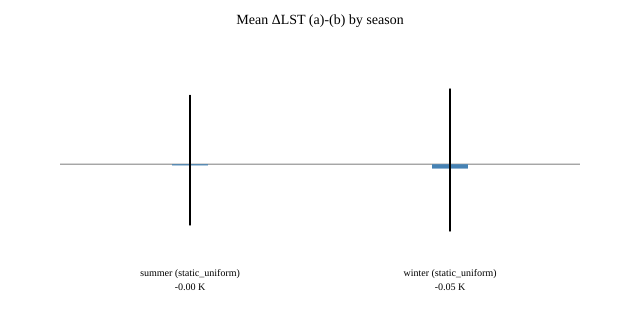
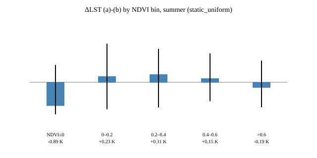
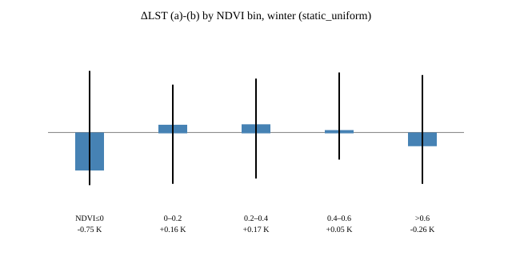
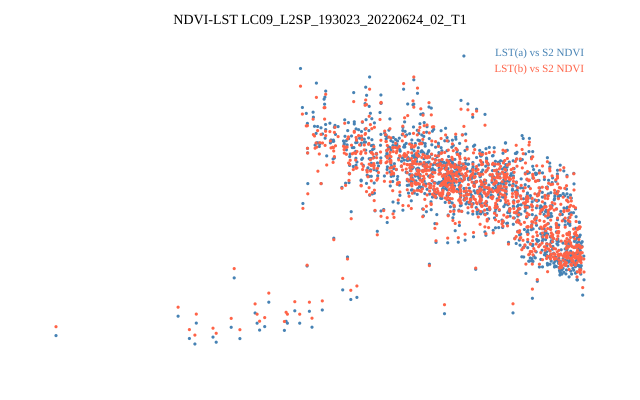

# Emissivity diagnostic: how much does ST_B10 depend on the scene-NDVI adjustment?

Read-only diagnostic (no training, no republish, no GCS writes — Planetary
Computer reads only). Run: `uv run python scripts/validators/diagnose_emissivity.py
--with-s2` (raw JSON/CSV/SVG land in the gitignored `.scratch/emissivity-diagnostic/`;
this report and the committed SVGs under `docs/emissivity-diagnostic/` are the
retained evidence). Physics in `src/berlin_lst_downscaling/analysis/emissivity.py`,
tests in `tests/test_emissivity.py`.

## Method

Per-pixel single-channel inversion (Cook/Malakar; USGS LSDS-1619):

```text
B(T) = ((TRAD - URAD) / ATRAN - (1 - eps) * DRAD) / eps
LST  = K2 / ln(K1 / B(T) + 1)
```

- Assets from PC collection `landsat-c2-l2`, loaded at 30 m in EPSG:32633 with
  explicit `resampling="nearest"`: `lwir11` (ST_B10), `qa_pixel`, `qa_radsat`,
  `emis`, `emsd`, `trad`, `urad`, `drad`, `atran`, `red`, `nir08`, plus `qa`
  (ST_QA product uncertainty, for context).
- Scales/offsets from the STAC `raster:bands` metadata, verified against the
  TIFF tags: ST `0.00341802/149`, TRAD/URAD/DRAD `0.001`, ATRAN/EMIS/EMSD
  `0.0001`, OLI SR `2.75e-05/-0.2`; nodata `-9999` (aux), fill DN 0 (ST).
- Thermal constants from the per-scene MTL (`mtl.json`, else `mtl.txt`, else the
  documented USGS constants): L8 B10 `K1=774.8853, K2=1321.0789`; L9 B10
  `K1=799.0284, K2=1329.2405`. Every scene's MTL constants matched the
  documented values exactly.
- Analysis mask: repo `landsat_qa_to_clear_bits` (fill/cloud/shadow/cirrus/snow
  excluded, water stays clear) + thermal saturation (ST DN 65535; TIRS has no
  QA_RADSAT bit — LSDS-1619 v6 Table 6-4 assigns bits 0–6 to OLI 1–7, bit 8 to
  OLI 9, bit 11 to terrain occlusion, bits 7/9/10/12–15 unused — and §6.1.2
  defines saturated thermal pixels by the uint16 maximum; verified bits 8–10
  unset in all 9 scenes, max QA_RADSAT 0–127 from optical bits only) + finite
  aux/EMIS. No clamps; invalid maps to NaN.
- Experiments: **(a)** `eps` = product EMIS (sanity vs ST_B10); **(b)** static
  emissivity without scene-NDVI adjustment (see source note); **(c)** fixed
  `eps` 0.97 / 0.98. Landsat SR NDVI bins for stratification; same-season S2
  NDVI (`--with-s2`: least-cloudy `sentinel-2-l2a` within ±16 d, repo ARD
  harmonized reflectance via `reflectance_scale_from_item`, SCL-clear join,
  averaged 10 m → 30 m with explicit resampling).

## Scene selection rule

Per season (JJA summer / DJF winter) × platform (L8/L9): lowest `eo:cloud_cover`
scenes over the Berlin bbox (13.08, 52.34, 13.76, 52.68) in PC STAC (2021–2025
window), preferring WRS-2 193/024; the winter pool is thin so adjacent paths are
accepted. The GCS v4 manifest bundle is not readable from this box (no GCS
credentials), so the PC catalog over the same AOI is the scene universe; all 9
pinned scenes fall inside the 2017–2026 selection window. Full Berlin AOI was
feasible (~17 s/scene), so no clipping was needed.

| scene | season | platform | clear frac | n analysis |
|---|---|---|---|---|
| LC08 193024 2024-08-24 | summer | L8 | 0.47 | 952 000 |
| LC08 193024 2023-06-03 | summer | L8 | 0.33 | 676 174 |
| LC08 193024 2023-09-07 | summer | L8 | 0.48 | 963 535 |
| LC09 193023 2022-06-24 | summer | L9 | 1.00 | 2 024 372 |
| LC09 192024 2022-07-19 | summer | L9 | 0.64 | 1 305 641 |
| LC09 193023 2022-08-11 | summer | L9 | 0.76 | 1 540 631 |
| LC08 192024 2023-01-19 | winter | L8 | 0.47 (20% snow in QA) | 947 991 |
| LC09 194023 2023-02-26 | winter | L9 | 0.01 (scene clips AOI corner) | 28 069 |
| LC09 194023 2024-01-28 | winter | L9 | 0.02 (scene clips AOI corner) | 47 527 |

## Emissivity source for (b), including fallback

ASTER GED v3 (AG100_003, 100 m, Hulley et al. 2015) granules require Earthdata
credentials for download (confirmed via CMR: collection is cloud-hosted but
gated); this read-only box has none, so the true static-GED branch could not
run. Documented fallback used: the scene-median EMIS applied uniformly — this
removes the *spatial* NDVI-adjustment pattern while keeping the scene mean, so
ΔLST (a)−(b) isolates the spatial-adjustment effect (it is not an absolute GED
product). The script accepts `--aster-ged-tif` (single-band B10-adjusted raster,
or a 5-band GED tile combined as mean of bands 13+14, whose 10.25–11.65 µm
passband brackets TIRS B10 10.6–11.19 µm, after Malakar et al. 2018 / Hulley et
al. 2015) for a rerun with real GED. Fixed-eps scenarios (c) bracket the
absolute-level sensitivity and reproduce the literature 0.5–1 K per 0.01
emissivity.

## (a) Sanity: reproduced ST_B10 per scene

| scene | n | max abs diff | mean abs diff | ST_QA mean | implied Δeps |
|---|---|---|---|---|---|
| L8 2024-08-24 | 952 000 | 0.156 K | 0.123 K | 4.19 K | +0.00194 |
| L8 2023-06-03 | 676 174 | 0.149 K | 0.119 K | 3.98 K | +0.00182 |
| L8 2023-09-07 | 963 535 | 0.145 K | 0.121 K | 3.35 K | +0.00185 |
| L9 2022-06-24 | 2 024 372 | 0.237 K | 0.167 K | 2.33 K | +0.00244 |
| L9 2022-07-19 | 1 305 641 | 0.234 K | 0.173 K | 2.20 K | +0.00245 |
| L9 2022-08-11 | 1 540 631 | 0.235 K | 0.164 K | 3.62 K | +0.00242 |
| L8 2023-01-19 | 947 991 | 0.131 K | 0.111 K | 4.07 K | +0.00201 |
| L9 2023-02-26 | 28 069 | 0.132 K | 0.115 K | 5.21 K | +0.00204 |
| L9 2024-01-28 | 47 527 | 0.128 K | 0.112 K | 3.84 K | +0.00199 |

**Verdict: the < 0.1 K target is NOT met** — the residual is a uniform warm
offset of 0.11–0.17 K (mean), max 0.13–0.24 K, on all 9 scenes, with no
saturated/fill pixels in the mask. Characterization: the residual is a
calibration-level constant, not scene-NDVI structure — the emissivity that
would reproduce ST_B10 exactly is EMIS + 0.0018…0.0024 uniformly (per-pixel std
of that offset ≈ 8e-05; bias grows only weakly with temperature). Scales were
verified against the TIFF tags and K1/K2 against each scene MTL, so the offset
sits in the operational chain (e.g. a runtime emissivity/cavity increment or a
radiance-level calibration detail), not in this inversion. Context: the offset
is 20–40× smaller than the product's own stated uncertainty (ST_QA mean
2.2–5.2 K). ΔLST (a)−(b) below is unaffected — both legs share the inversion,
so the constant cancels.

## ΔLST (a)−(b): overall per scene group (K; mean, [p05, p95])

| group | static-uniform | fixed 0.97 | fixed 0.98 |
|---|---|---|---|
| summer L8 (3 scenes) | −0.03, [−0.90, +0.92] | −0.22, [−1.11, +0.75] | +0.43, [−0.49, +1.41] |
| summer L9 (3 scenes) | +0.01, [−0.94, +1.07] | −0.20, [−1.09, +0.89] | +0.49, [−0.43, +1.60] |
| winter L8 (1 scene) | −0.07, [−1.04, +0.67] | −0.14, [−1.11, +0.60] | +0.41, [−0.56, +1.15] |
| winter L9 (2 scenes) | +0.12, [−0.25, +1.17] | −0.57, [−0.98, +0.44] | +0.00, [−0.40, +1.01] |

Scene-mean EMIS is 0.972–0.974 (summer) and 0.971/0.982 (winter scenes), so the
fixed scenarios bracket it and confirm ~0.5–1 K per 0.01 emissivity. Headline:
removing the spatial NDVI adjustment moves the scene mean by ≤ 0.11 K, but
moves individual clear pixels by up to ~±1 K (p05/p95).

## ΔLST (a)−(b) by NDVI bin (static-uniform; n-weighted mean, [min p05, max p95])

| season | NDVI≤0 | 0–0.2 | 0.2–0.4 | 0.4–0.6 | >0.6 |
|---|---|---|---|---|---|
| summer | −0.89, [−1.24, +0.67] | +0.23, [−1.04, +1.49] | +0.31, [−0.98, +1.29] | +0.15, [−0.73, +1.11] | −0.19, [−0.96, +0.83] |
| winter | −0.75, [−1.07, +1.25] | +0.16, [−1.04, +0.97] | +0.17, [−0.93, +1.09] | +0.05, [−0.55, +1.21] | −0.26, [−1.04, +1.16] |

Pattern is consistent across seasons/platforms: the NDVI adjustment
warms dense vegetation (negative Δ = (a)−(b) means the static run is warmer …
i.e. the adjustment cools dense canopies by ~0.2–0.3 K) and water/negative NDVI
(~−0.9 K), while slightly warming sparse/low NDVI (~+0.2–0.3 K).

## ΔLST (a)−(b) by surface: land vs water (static-uniform; QA_PIXEL bit 7)

Water emissivity (~0.99) sits well above the scene-median static value, so the
uniform run is warm-biased over water — the NDVI adjustment cools summer water
pixels by ~0.9 K. Winter water samples are thin (corner-clipped scenes).

| group | land mean, [p05, p95], n | water mean, [p05, p95], n |
|---|---|---|
| summer L8 | +0.00, [−0.84, +0.94], 2 497 129 | −0.90, [−1.17, −0.85], 94 580 |
| summer L9 | +0.03, [−0.91, +1.08], 4 752 805 | −0.91, [−1.28, −0.86], 116 839 |
| winter L8 | −0.03, [−1.04, +0.68], 884 367 | −0.54, [−1.06, +0.56], 63 624 |
| winter L9 | +0.12, [−0.24, +1.17], 75 380 | −0.03, [−0.54, +1.18], 216 |





## NDVI–LST relation: slope (K per unit NDVI) and r for (a) vs (b)

| scene | Landsat NDVI → LST(a) | Landsat NDVI → LST(b) | S2 NDVI → LST(a) | S2 NDVI → LST(b) |
|---|---|---|---|---|
| L8 2024-08-24 | −4.21, r=−0.26 | −3.74, r=−0.26 | −5.73, r=−0.40 (n=8k) | −5.25, r=−0.40 |
| L8 2023-06-03 | −16.01, r=−0.51 | −14.98, r=−0.50 | −5.85, r=−0.23 (n=116k) | −5.60, r=−0.23 |
| L8 2023-09-07 | −0.68, r=−0.11 | −0.59, r=−0.10 | +1.31, r=+0.13 (n=253k) | +1.28, r=+0.15 |
| L9 2022-06-24 | −7.21, r=−0.39 | −6.46, r=−0.38 | −6.96, r=−0.40 (n=1.44M) | −6.24, r=−0.39 |
| L9 2022-07-19 | −10.31, r=−0.49 | −9.41, r=−0.48 | −8.70, r=−0.42 (n=691k) | −7.92, r=−0.41 |
| L9 2022-08-11 | −1.52, r=−0.20 | −1.40, r=−0.19 | −17.89, r=−0.73 (n=7k) | −17.16, r=−0.71 |
| L8 2023-01-19 | −0.00, r=−0.01 | −0.00, r=−0.01 | −3.81, r=−0.91 (n=3.8k) | −3.79, r=−0.91 |
| L9 2023-02-26 | −0.00, r=−0.00 | −0.00, r=−0.00 | n/a (0 joint clear px) | n/a |
| L9 2024-01-28 | −1.59, r=−0.37 | −0.55, r=−0.16 | −1.54, r=−0.40 (n=48k) | −0.60, r=−0.19 |

The NDVI adjustment steepens the NDVI–LST slope by ~5–10% in summer (e.g.
−7.21 vs −6.46) and dramatically in the 2024-01-28 winter scene (−1.59 vs
−0.55, confirmed by both Landsat and S2 NDVI): with static emissivity the
winter NDVI–LST relation nearly vanishes (r −0.37 → −0.16). Correlations are
otherwise preserved. S2 joins are partial (companions cover only part of the
mask); two low-n S2 slopes (2022-08-11, 2023-01-19) are edge-sample artefacts
and not interpreted; the primary result is the full-sample Landsat-NDVI pair.



## Limitations (all read-only; nothing written to GCS, no training, no jobs)

- Impervious-class stratification is not implemented: the project's
  imperviousness (Umweltatlas-derived) and stadtstruktur (WFS-derived) layers
  exist only as GCS products / pipeline outputs, unreachable read-only from
  this box (no GCS credentials; regenerating them would be a product-writing
  pipeline run, out of scope). Land-cover stratification is by Landsat SR NDVI
  bins plus the Fmask water/land split above.
- No true static-AST GED branch (Earthdata credentials); fallback documented
  above, rerunnable via `--aster-ged-tif`.
- Winter L9 samples are thin (28k/47k px, corner-clipped scenes); one winter
  scene has no joint S2 pixels.
- Sanity residual 0.11–0.17 K exceeds the 0.1 K target (uniform constant, see
  above); reported as not met rather than tuned away.
