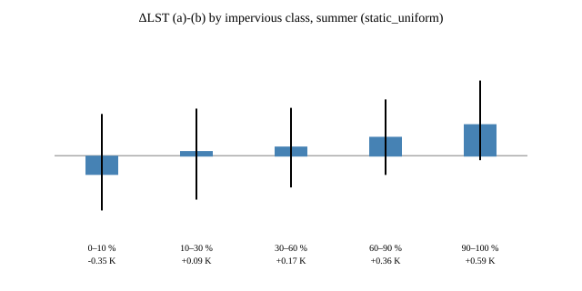
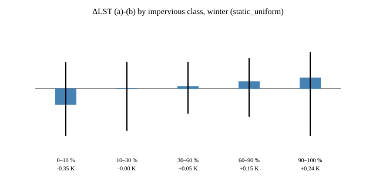

# Emissivity diagnostic: how much does ST_B10 depend on the scene-NDVI adjustment?

Read-only diagnostic (no training, no republish, no GCS writes — Planetary
Computer reads plus local published-COG copies only). Run:
`EARTHDATA_TOKEN=... uv run python scripts/validators/diagnose_emissivity.py
--with-s2 --impervious-tif .scratch/imperviousness-v3 --aster-ged` (needs
`EARTHDATA_TOKEN` in the environment; tiles are cached in
`.scratch/aster-ged-v3/`) (raw JSON/CSV/SVG land in the
gitignored `.scratch/emissivity-diagnostic/`; this report and the committed
SVGs under `docs/emissivity-diagnostic/` are the retained evidence). Physics
in `src/berlin_lst_downscaling/analysis/emissivity.py`, tests in
`tests/test_emissivity.py`.

> **What (b) and (c) measure.** Variant (b) is the real *static* ASTER GED v3
> (AG100.003) emissivity, spectrally adjusted to TIRS B10 with the Malakar
> 2018 coefficients (`0.6820 * eps13 + 0.2578 * eps14 + 0.0584`;
> doi:10.1109/TGRS.2018.2824828) and with NO NDVI/vegetation/water/snow
> adjustment. Hence (a)−(b) isolates the scene-NDVI/phenology adjustment of
> the C2 ST product, up to the GED/TIRS spectral-fit error and the 100 m →
> 30 m bilinear resampling error, and land-cover change since the 2000–2008
> GED period. Landsat 9 uses the L8 coefficients
> (labelled approximation; open question). Variant (c) is the uniform
> scene-median EMIS (`uniform_median`), which removes ALL spatial emissivity
> structure and is therefore an **upper bound on the spatial-pattern
> effect**, plus fixed 0.97 / 0.98.

## Method

Per-pixel single-channel inversion (Cook/Malakar; USGS LSDS-1619):

```text
B(T) = ((TRAD - URAD) / ATRAN - (1 - eps) * DRAD) / eps
LST  = K2 / ln(K1 / B(T) + 1)
```

- Assets from PC collection `landsat-c2-l2`, loaded at 30 m in EPSG:32633 with
  explicit `resampling="nearest"`: `lwir11` (ST_B10), `qa_pixel`, `qa_radsat`,
  `emis`, `emsd`, `trad`, `urad`, `drad`, `atran`, `red`, `nir08`, plus `qa`
  (ST_QA product uncertainty, for context).
- Scales/offsets from the STAC `raster:bands` metadata, verified against the
  TIFF tags: ST `0.00341802/149`, TRAD/URAD/DRAD `0.001`, ATRAN/EMIS/EMSD
  `0.0001`, OLI SR `2.75e-05/-0.2`; nodata `-9999` (aux), fill DN 0 (ST).
- Thermal constants from the per-scene MTL (`mtl.json`, else `mtl.txt`, else the
  documented USGS constants): L8 B10 `K1=774.8853, K2=1321.0789`; L9 B10
  `K1=799.0284, K2=1329.2405`. Every scene's MTL constants matched the
  documented values exactly.
- Analysis mask: repo `landsat_qa_to_clear_bits` (fill/cloud/shadow/cirrus/snow
  excluded, water stays clear) + thermal saturation (ST DN 65535; TIRS has no
  QA_RADSAT bit — LSDS-1619 v6 Table 6-4 assigns bits 0–6 to OLI 1–7, bit 8 to
  OLI 9, bit 11 to terrain occlusion, bits 7/9/10/12–15 unused — and §6.1.2
  defines saturated thermal pixels by the uint16 maximum; verified bits 8–10
  unset in all 9 scenes, max QA_RADSAT 0–127 from optical bits only) + finite
  aux/EMIS. No clamps; invalid maps to NaN.
- Experiments: **(a)** `eps` = product EMIS (sanity vs ST_B10); **(b)**
  `static_ged`: ASTER GED v3 discovered through NASA CMR
  (`short_name=AG100`, `version=003`, bbox query), downloaded from LP DAAC with
  the Earthdata bearer token from env `EARTHDATA_TOKEN`, georeferenced from the
  pixel-centre geolocation arrays (spacing 1/999°, half-pixel edge shift,
  regularity checked), spectrally adjusted on the native 100 m grid
  (Malakar 2018) and only then bilinearly reprojected to the 30 m EPSG:32633
  scene grid; GED NaN pixels are excluded and counted
  (`ged_frac_invalid_in_analysis_mask`), never filled; **(c)** `uniform_median`
  (scene-median EMIS everywhere, upper bound on the spatial-pattern effect) plus
  fixed `eps` 0.97 / 0.98. Landsat SR NDVI bins, Fmask water/land,
  and impervious classes (published v3 COGs, `--impervious-tif`) for
  stratification; same-season S2 NDVI (`--with-s2`: least-cloudy
  `sentinel-2-l2a` within ±16 d, repo ARD harmonized reflectance via
  `reflectance_scale_from_item`, SCL-clear join, averaged 10 m → 30 m with
  explicit resampling).

## Scene selection rule

Per season (JJA summer / DJF winter) × platform (L8/L9): lowest `eo:cloud_cover`
scenes over the Berlin bbox (13.08, 52.34, 13.76, 52.68) in PC STAC (2021–2025
window), preferring WRS-2 193/024; the winter pool is thin so adjacent paths are
accepted. The GCS v4 manifest bundle is not readable from this box (no GCS
credentials), so the PC catalog over the same AOI is the scene universe; all 9
pinned scenes fall inside the 2017–2026 selection window. Full Berlin AOI was
feasible (~17 s/scene), so no clipping was needed.

| scene | season | platform | clear frac | n analysis |
|---|---|---|---|---|
| LC08 193024 2024-08-24 | summer | L8 | 0.47 | 952 000 |
| LC08 193024 2023-06-03 | summer | L8 | 0.33 | 676 174 |
| LC08 193024 2023-09-07 | summer | L8 | 0.48 | 963 535 |
| LC09 193023 2022-06-24 | summer | L9 | 1.00 | 2 024 372 |
| LC09 192024 2022-07-19 | summer | L9 | 0.64 | 1 305 641 |
| LC09 193023 2022-08-11 | summer | L9 | 0.76 | 1 540 631 |
| LC08 192024 2023-01-19 | winter | L8 | 0.47 (20% snow in QA) | 947 991 |
| LC09 194023 2023-02-26 | winter | L9 | 0.01 (scene clips AOI corner) | 28 069 |
| LC09 194023 2024-01-28 | winter | L9 | 0.02 (scene clips AOI corner) | 47 527 |

## Emissivity source for (b): static ASTER GED v3

ASTER GED v3 (AG100.003, 100 m, 2000–2008 mean; Hulley et al. 2015) is found
through NASA CMR (granule search by bbox, https `.h5` links only; no tile is
hard-coded) and downloaded from LP DAAC with `Authorization: Bearer
$EARTHDATA_TOKEN` (the token is never logged, never put in a URL, and scrubbed
from errors; a missing token fails immediately, before any Planetary Computer
access). Tiles are cached in `.scratch/aster-ged-v3/`; a valid cached tile
skips the download (CMR discovery and the token are still required per run). `Emissivity/Mean` bands 13/14 (integer DN × 0.001, DN ≤ 0 = fill →
NaN) are spectrally adjusted to TIRS B10 with Malakar et al. 2018
(IEEE TGRS 56(10):5717–5735, doi:10.1109/TGRS.2018.2824828; same coefficients
in Ermida et al. 2020): `0.6820 * eps13 + 0.2578 * eps14 + 0.0584`, with no
clamping and no NDVI/vegetation/water/snow adjustment. The HDF5 file has no
usable geotransform, so it is rebuilt from the pixel-centre
`Geolocation/Latitude|Longitude` arrays (1000 samples including both tile ends
⇒ spacing 1/999°, edge = centre − half a pixel); irregular or rotated
geolocation raises. The adjustment runs on the native 100 m grid and the result
is then bilinearly reprojected (explicit resampling, NaN as nodata) to the
30 m EPSG:32633 scene grid. GED NaN or out-of-range pixels are excluded from
(b) and counted per scene (`ged_n_invalid_in_analysis_mask`,
`ged_frac_invalid_in_analysis_mask`); they are never filled. Note: GDAL
bilinear with NaN nodata re-weights over the valid 100 m neighbours, so only
30 m pixels whose centre falls in an invalid GED cell become NaN; the counts
are on the 30 m grid. Offline,
`--aster-ged-tif` accepts a local single-band B10 raster or a 5-band GED tile
(same Malakar adjustment); it is mutually exclusive with `--aster-ged`.
Without either flag, (b) is absent.

Variant (c): the scene-median EMIS applied uniformly (`uniform_median`) removes
the static spatial pattern in EMIS together with the NDVI adjustment, so
(a)−(c) is an **upper bound** on the spatial emissivity effect. Fixed-eps
scenarios (c) bracket the absolute-level sensitivity and reproduce the
literature 0.5–1 K per 0.01 emissivity.

## (a) Sanity: reproduced ST_B10 per scene

| scene | n | max abs diff | mean abs diff | ST_QA mean | implied Δeps |
|---|---|---|---|---|---|
| L8 2024-08-24 | 952 000 | 0.156 K | 0.123 K | 4.19 K | +0.00194 |
| L8 2023-06-03 | 676 174 | 0.149 K | 0.119 K | 3.98 K | +0.00182 |
| L8 2023-09-07 | 963 535 | 0.145 K | 0.121 K | 3.35 K | +0.00185 |
| L9 2022-06-24 | 2 024 372 | 0.237 K | 0.167 K | 2.33 K | +0.00244 |
| L9 2022-07-19 | 1 305 641 | 0.234 K | 0.173 K | 2.20 K | +0.00245 |
| L9 2022-08-11 | 1 540 631 | 0.235 K | 0.164 K | 3.62 K | +0.00242 |
| L8 2023-01-19 | 947 991 | 0.131 K | 0.111 K | 4.07 K | +0.00201 |
| L9 2023-02-26 | 28 069 | 0.132 K | 0.115 K | 5.21 K | +0.00204 |
| L9 2024-01-28 | 47 527 | 0.128 K | 0.112 K | 3.84 K | +0.00199 |

**Verdict: the < 0.1 K target is NOT met** — the residual is a uniform warm
offset of 0.11–0.17 K (mean), max 0.13–0.24 K, on all 9 scenes, with no
saturated/fill pixels in the mask. Characterization: the residual is a
calibration-level constant, not scene-NDVI structure — the emissivity that
would reproduce ST_B10 exactly is EMIS + 0.0018…0.0024 uniformly (per-pixel std
of that offset ≈ 8e-05; bias grows only weakly with temperature). Scales were
verified against the TIFF tags and K1/K2 against each scene MTL, so the offset
sits in the operational chain (e.g. a runtime emissivity/cavity increment or a
radiance-level calibration detail), not in this inversion. Context: the offset
is 20–40× smaller than the product's own stated uncertainty (ST_QA mean
2.2–5.2 K). ΔLST (a)−(c) below is unaffected — both legs share the inversion,
so the constant cancels.

> The numbers and tables below are from the PR #93 run with the uniform
> scene-median emissivity, i.e. variant (c) `uniform_median` (and the fixed
> scenarios, also (c)). The committed SVGs in `docs/emissivity-diagnostic/`
> are from that same run and show (c). Static-GED (b) results are not yet
> produced.

## ΔLST (a)−(c): overall per scene group (K; mean, [p05, p95])

| group | uniform median (c) | (c) fixed 0.97 | (c) fixed 0.98 |
|---|---|---|---|
| summer L8 (3 scenes) | −0.03, [−0.90, +0.92] | −0.22, [−1.11, +0.75] | +0.43, [−0.49, +1.41] |
| summer L9 (3 scenes) | +0.01, [−0.94, +1.07] | −0.20, [−1.09, +0.89] | +0.49, [−0.43, +1.60] |
| winter L8 (1 scene) | −0.07, [−1.04, +0.67] | −0.14, [−1.11, +0.60] | +0.41, [−0.56, +1.15] |
| winter L9 (2 scenes) | +0.12, [−0.25, +1.17] | −0.57, [−0.98, +0.44] | +0.00, [−0.40, +1.01] |

Scene-mean EMIS is 0.972–0.974 (summer) and 0.971/0.982 (winter scenes), so the
fixed scenarios bracket it and confirm ~0.5–1 K per 0.01 emissivity.
Headline: removing all spatial emissivity structure moves the scene mean by
≤ 0.12 K — an upper bound on what the NDVI adjustment alone can do to the
mean — but moves individual clear pixels by up to ~±1 K (p05/p95).

(b) results: pending run with `--aster-ged`.

## ΔLST (a)−(c) by NDVI bin (uniform median (c); n-weighted mean, [min p05, max p95])

| season | NDVI≤0 | 0–0.2 | 0.2–0.4 | 0.4–0.6 | >0.6 |
|---|---|---|---|---|---|
| summer | −0.89, [−1.24, +0.67] | +0.23, [−1.04, +1.49] | +0.31, [−0.98, +1.29] | +0.15, [−0.73, +1.11] | −0.19, [−0.96, +0.83] |
| winter | −0.75, [−1.07, +1.25] | +0.16, [−1.04, +0.97] | +0.17, [−0.93, +1.09] | +0.05, [−0.55, +1.21] | −0.26, [−1.04, +1.16] |

Pattern is consistent across seasons/platforms: the NDVI adjustment
warms dense vegetation (negative Δ = (a)−(c) means the static run is warmer …
i.e. the adjustment cools dense canopies by ~0.2–0.3 K) and water/negative NDVI
(~−0.9 K), while slightly warming sparse/low NDVI (~+0.2–0.3 K).

(b) results: pending run with `--aster-ged`.

## ΔLST (a)−(c) by surface: land vs water (uniform median (c); QA_PIXEL bit 7)

Water emissivity (~0.99) sits well above the scene-median static value, so the
uniform run is warm-biased over water — the NDVI adjustment cools summer water
pixels by ~0.9 K. Winter water samples are thin (corner-clipped scenes).

| group | land mean, [p05, p95], n | water mean, [p05, p95], n |
|---|---|---|
| summer L8 | +0.00, [−0.84, +0.94], 2 497 129 | −0.90, [−1.17, −0.85], 94 580 |
| summer L9 | +0.03, [−0.91, +1.08], 4 752 805 | −0.91, [−1.28, −0.86], 116 839 |
| winter L8 | −0.03, [−1.04, +0.68], 884 367 | −0.54, [−1.06, +0.56], 63 624 |
| winter L9 | +0.12, [−0.24, +1.17], 75 380 | −0.03, [−0.54, +1.18], 216 |

(b) results: pending run with `--aster-ged`.

## ΔLST (a)−(c) by impervious class (uniform median (c); upper bound)

Published imperviousness v3 COGs (float32 sealing percent [0, 100], NaN
nodata), used read-only from local copies — no GCS access in code
(`--impervious-tif` takes a single COG or the v3 directory; vintage rule
reuses the project's canonical `vintage_for_scene_year`: up to and including
2019 → 2016, otherwise 2021 — all 9 pinned scenes are 2022–2024, i.e. 2021
throughout). The 10 m percent field is area-averaged
onto the 30 m scene grid (documented method: continuous percent field, same
rationale as the repo's own imperviousness 2.5 m → 10 m step; NaN
propagates). Classes: 0–10 / 10–30 / 30–60 / 60–90 / 90–100 %.

| group | 0–10 % | 10–30 % | 30–60 % | 60–90 % | 90–100 % |
|---|---|---|---|---|---|
| summer L8 | −0.37, [−0.98, +0.60], 587k | +0.07, [−0.76, +0.79], 184k | +0.17, [−0.54, +0.80], 313k | +0.34, [−0.29, +0.93], 274k | +0.58, [−0.01, +1.20], 114k |
| summer L9 | −0.33, [−1.03, +0.79], 883k | +0.10, [−0.83, +0.89], 296k | +0.18, [−0.60, +0.90], 524k | +0.37, [−0.36, +1.06], 473k | +0.60, [−0.09, +1.42], 217k |
| winter L8 | −0.35, [−1.04, +0.57], 204k | −0.00, [−0.93, +0.58], 78k | +0.05, [−0.55, +0.58], 143k | +0.16, [−0.62, +0.66], 135k | +0.24, [−1.04, +0.79], 59k |
| winter L9 | n/a (no overlap with the product's valid area) | — | — | — | — |

The cleanest gradient in the study, identical across platforms: the uniform
run is progressively warmer than the NDVI-adjusted product as sealing rises
(low-emissivity sealed surfaces retrieve warmer with their true low `eps`
than with the scene median). Physics check passed: sign and magnitude match
the per-pixel sensitivity. Winter L9 corner-clipped scenes fall outside the
product's valid area (E ≥ 372 360 m / N ≤ 582 8940 m in the NW overlap box),
hence n/a — reported, not filled.




NDVI–LST slopes stratified by impervious class (same arrays, Landsat NDVI;
uniform median as (c); winter L9 n/a — no product overlap):

| class | summer L8 2024-08-24: slope (a) / (c), r | winter L8 2023-01-19: slope (a) / (c), r |
|---|---|---|
| 0–10 % | +4.67 / +4.17, r=+0.42 | −0.00 / −0.00, r=−0.00 |
| 10–30 % | −8.57 / −7.67, r=−0.49 | −0.01 / −0.01, r=−0.04 |
| 30–60 % | −7.06 / −6.25, r=−0.49 | −0.01 / −0.01, r=−0.03 |
| 60–90 % | −5.95 / −5.26, r=−0.50 | −0.00 / −0.00, r=−0.01 |
| 90–100 % | −6.92 / −6.31, r=−0.48 | −0.00 / −0.00, r=−0.01 |

Within every sealed summer class the adjustment steepens the NDVI–LST slope
by ~10% while leaving the correlation untouched — the same upper-bound
pattern as the whole-scene relation. In winter there is no NDVI–LST relation
in any class (January, dormant vegetation), under either emissivity. (Full
per-scene stratified numbers: `.scratch/emissivity-diagnostic/per_scene.json`
→ `relations` → `imperv_stratified`.)


(b) results: pending run with `--aster-ged`.

## NDVI–LST relation: slope (K per unit NDVI) and r for (a) vs (c)

| scene | Landsat NDVI → LST(a) | Landsat NDVI → LST(c) | S2 NDVI → LST(a) | S2 NDVI → LST(c) |
|---|---|---|---|---|
| L8 2024-08-24 | −4.21, r=−0.26 | −3.74, r=−0.26 | −5.73, r=−0.40 (n=8k) | −5.25, r=−0.40 |
| L8 2023-06-03 | −16.01, r=−0.51 | −14.98, r=−0.50 | −5.85, r=−0.23 (n=116k) | −5.60, r=−0.23 |
| L8 2023-09-07 | −0.68, r=−0.11 | −0.59, r=−0.10 | +1.31, r=+0.13 (n=253k) | +1.28, r=+0.15 |
| L9 2022-06-24 | −7.21, r=−0.39 | −6.46, r=−0.38 | −6.96, r=−0.40 (n=1.44M) | −6.24, r=−0.39 |
| L9 2022-07-19 | −10.31, r=−0.49 | −9.41, r=−0.48 | −8.70, r=−0.42 (n=691k) | −7.92, r=−0.41 |
| L9 2022-08-11 | −1.52, r=−0.20 | −1.40, r=−0.19 | −17.89, r=−0.73 (n=7k) | −17.16, r=−0.71 |
| L8 2023-01-19 | −0.00, r=−0.01 | −0.00, r=−0.01 | −3.81, r=−0.91 (n=3.8k) | −3.79, r=−0.91 |
| L9 2023-02-26 | −0.00, r=−0.00 | −0.00, r=−0.00 | n/a (0 joint clear px) | n/a |
| L9 2024-01-28 | −1.59, r=−0.37 | −0.55, r=−0.16 | −1.54, r=−0.40 (n=48k) | −0.60, r=−0.19 |

The NDVI adjustment steepens the NDVI–LST slope by ~5–10% in summer (e.g.
−7.21 vs −6.46) and dramatically in the 2024-01-28 winter scene (−1.59 vs
−0.55, confirmed by both Landsat and S2 NDVI): with static emissivity the
winter NDVI–LST relation nearly vanishes (r −0.37 → −0.16). Correlations are
otherwise preserved. S2 joins are partial (companions cover only part of the
mask); two low-n S2 slopes (2022-08-11, 2023-01-19) are edge-sample artefacts
and not interpreted; the primary result is the full-sample Landsat-NDVI pair.


(b) results: pending run with `--aster-ged`.

## Limitations (all read-only; nothing written to GCS, no training, no jobs)

- Impervious-class stratification uses the published v3 COGs (2021 vintage
  for all pinned scenes); stadtstruktur classes are not joined (WFS-derived
  pipeline product, same availability reason as before — out of scope).
  Land-cover stratification is NDVI bins + Fmask water/land + impervious
  classes.
- The static-GED branch (b) is implemented (`--aster-ged`); its numbers are
  pending a run with an Earthdata token. Open points: Landsat 9 uses the L8
  Malakar coefficients (approximation; Malakar 2018 predates L9, TIRS-2 B10 RSR
  is near-identical), and GED is a 2000–2008 mean vintage compared with
  2022–2024 scene dates (land-cover change appears as (a)−(b) signal).
- Winter L9 samples are thin (28k/47k px, corner-clipped scenes); one winter
  scene has no joint S2 pixels.
- Sanity residual 0.11–0.17 K exceeds the 0.1 K target (uniform constant, see
  above); reported as not met rather than tuned away.
