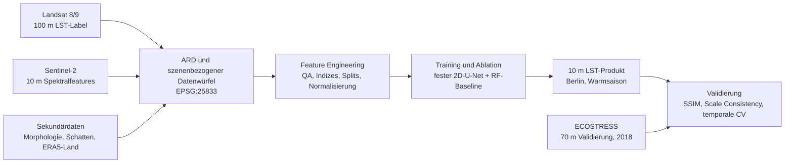
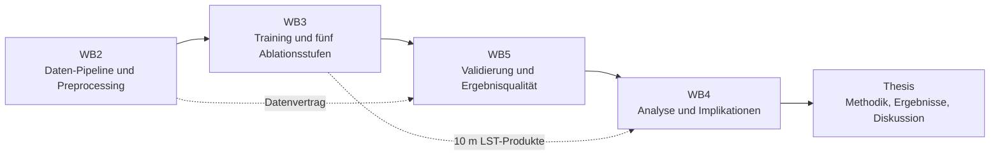
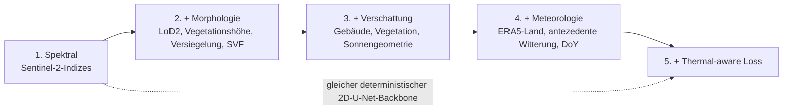

# Visuals & Präsentationen

> Migriert aus Notion am 2026-10-28 (Seite `b99a5ea6ae9d4d7c8f91b978d81a3d4a`, zuletzt bearbeitet 2026-07-21). Text unverändert übernommen.

## Zweck

Arbeitsbereich für wiederverwendbare Präsentationskonzepte, technische Diagramme, Infografiken und Datenvisualisierungen der Masterarbeit. Inhaltliche Aussagen bleiben an Project Memory, WB1–WB5 und den jeweiligen Ergebnisdokumenten gebunden.

## Visueller Grundstil

- Editorial und minimal: weißer Grund, Anthrazit als Textfarbe, Blau als Standardakzent.
- Eine Kernaussage pro Folie oder Grafik. Großzügiger Weißraum, klare Hierarchie, keine dekorativen Elemente ohne Funktion.
- Karten, Daten und methodische Logik stehen vor generischen Illustrationen.
- Konsistente Typografie, Achsen, Legenden, Kartenrahmen und Quellenzeilen.
- Semantik: Grün = valide oder erledigt, Orange = offen, Rot = Risiko oder Fehler.

## Präsentationskonzept v0.1

**Zielgruppe:** Betreuung und fachlich interessierte Personen.

**Erzählung:** Problem und Forschungslücke → Daten und methodischer Ansatz → aktueller Umsetzungsstand → nächste Entscheidungen und Schritte.

### Standardstruktur für Status- oder Betreuungsdeck

1. Ausgangslage, Ziel und Forschungsfrage
2. Forschungslücke und wissenschaftlicher Beitrag
3. Datenbasis und räumlich-zeitliche Auflösung
4. End-to-End-Ablauf von Quellen bis Trainingsdaten
5. Ablationsdesign und Hypothesen
6. Aktueller Daten- und Pipeline-Status
7. Validierungslogik und bekannte Limitationen
8. Nächste Schritte und Entscheidungsbedarf

## Diagramm- und Infografik-Backlog

- [x] **End-to-End-Pipeline:** Landsat, Sentinel-2, Sekundärdaten und ECOSTRESS bis zum 10-m-LST-Produkt.
- [x] **Phasenmodell:** WB2 Daten-Pipeline → WB3 Training und Ablation → WB5 Validierung → WB4 Analyse und Implikationen → Schreiben.
- [x] **Ablationsleiter:** Spektral → +Morphologie → +Verschattung und Sonnengeometrie → +Meteorologie → +Thermal-aware Loss.
- [ ] **Pseudo-Pair-Prinzip:** Training auf künstlich vergröberten Skalen, Anwendung auf 100 m → 10 m.
- [ ] **Validierungsdreieck:** Scale Consistency, SSIM und temporale CV, ergänzt durch ECOSTRESS für 2018.

## Technische Diagramme v0.1

### End-to-End-Pipeline

### Phasenmodell

### Ablationsleiter

## Arbeitsmodus

- Mermaid dient als versionierbare technische Quelle für Notion und Repository.
- Präsentations- und Thesis-Grafiken werden als eigenständige, lesbare Visuals umgesetzt.
- Jedes Visual erhält Titel, Kernaussage, Daten- oder Quellenzeile und Versionsstand.
- Gestaltung wird anhand konkreter Artefakte iterativ weiterentwickelt.
